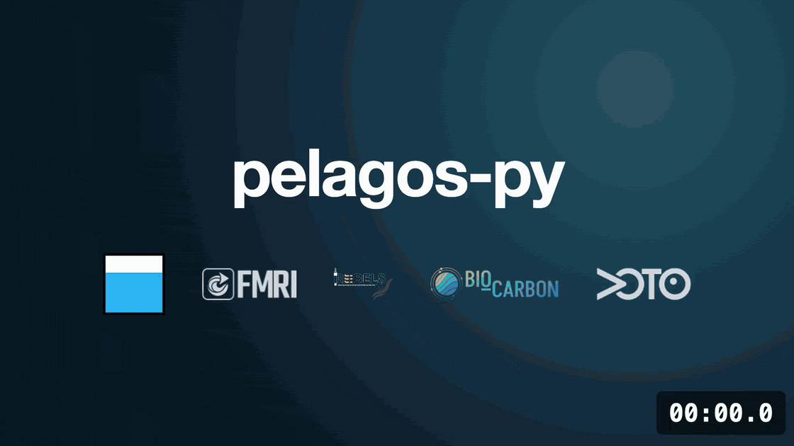

<p align="center">
  
</p>

# pelagos-py

pelagos-py processes glider and other autonomous-platform data in OG1 format into science-ready datasets. A pipeline is a sequence of steps (loading, quality control, corrections, export) built from a single YAML config file, so processing can be reproduced by sharing the config.



## Installation

```bash
pip install pelagos-py
```

Or from source:

```bash
git clone https://github.com/NOC-OBG-Autonomy/pelagos-py.git
cd pelagos-py
pip install -e .
```

## Quick start

Build a config for the demo file (downloaded on first use) and run it:

```python
from pelagos_py import Pipeline, get_demo_file

pipeline = Pipeline.make_config(get_demo_file())
pipeline.run()
```

`make_config` saves the config as a YAML file next to the data, ready to edit and rerun with `Pipeline.load_config`.

### Dashboard

A local web page to build, check and run configs, with live logs and diagnostic plots:

```bash
pelagos-py dashboard              # opens http://localhost:8791
```

### Command line

```bash
pelagos-py build glider.nc        # writes glider.yaml
pelagos-py run glider.nc          # builds a config, then runs it
pelagos-py run my_pipeline.yaml   # runs an existing config
pelagos-py demo                   # downloads the demo file and prints its path
```

## Documentation

- [Getting Started](https://noc-obg-autonomy.github.io/pelagos-py/getting_started.html): installation, running a pipeline and an example config
- [User Guide](https://noc-obg-autonomy.github.io/pelagos-py/user_guide.html): how each variable is processed
- [API Reference](https://noc-obg-autonomy.github.io/pelagos-py/api_reference.html): every step and its parameters
- [Contributing](https://github.com/NOC-OBG-Autonomy/pelagos-py/blob/main/CONTRIBUTING.md): reporting issues and developing pelagos-py

## License

[Apache 2.0 License](https://www.apache.org/licenses/LICENSE-2.0)

## Try it without installing

You can try out pelagos-py without installing it through MyBinder. Click the "Launch Binder" button below. 

[](https://mybinder.org/v2/gh/NOC-OBG-Autonomy/pelagos-py/mybinder)

Copyright 2025-2026 The National Oceanography Centre and contributors.
