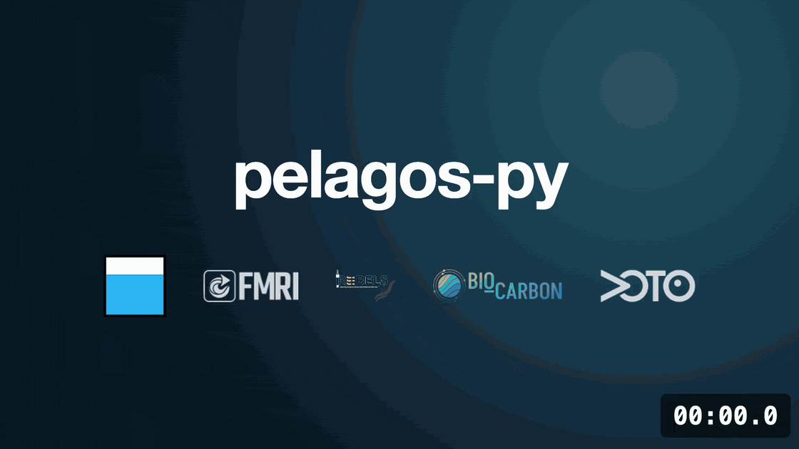

pelagos-py documentation
========================

:Version: |release|

pelagos-py, from the NOC (National Oceanography Centre) Autonomy group, is a modular processing pipeline for raw
OG1-format glider and ALR data that outputs science-ready datasets. You control it through a single YAML config file, so a
processing method can be shared and reproduced by sharing the raw data and the config.

It covers a broad and growing range of oceanographic variables. Suggestions are always welcome, and adding your own steps
is kept as simple as possible: see :doc:`Development<development>`.

The tool is written in Python, but using it needs little Python. In most cases processing takes a few lines:

.. code-block:: python

   from pelagos_py import Pipeline

   # Create the pipeline using the specified config
   Pipeline.load_config("config.yaml").run()

   # Or build a config for an OG1 file from the default template, then run it
   Pipeline.make_config("glider.nc").run()

The main work is writing your ``config.yaml``, which sets how the raw data is processed. ``make_config`` builds one for your
file to start from, and ``examples/configs/all_step_configs.yaml`` documents every step's options. If anything doesn't make
sense, let us know so we can improve it.

----

.. grid:: 1 2 2 2
   :gutter: 3

   .. grid-item-card::
      :text-align: center

      .. image:: _static/index_getting_started.svg
         :height: 80px
         :class: only-light card-svg

      .. image:: _static/index_getting_started_dark.svg
         :height: 80px
         :class: only-dark card-svg

      **Getting started**

      New to pelagos-py? Start here with our installation instructions and a brief overview of the tool.

      .. button-ref:: getting_started
         :ref-type: doc
         :expand:
         :color: primary
         :click-parent:

         To the getting started guide

   .. grid-item-card::
      :text-align: center

      .. image:: _static/index_user_guide.svg
         :height: 80px
         :class: only-light card-svg

      .. image:: _static/index_user_guide_dark.svg
         :height: 80px
         :class: only-dark card-svg

      **User guide**

      Ready to deepen your understanding? Visit the user guide for detailed explanations of the processing steps and how to configure them.

      .. button-ref:: user_guide
         :ref-type: doc
         :expand:
         :color: primary
         :click-parent:

         To the user guide

   .. grid-item-card::
      :text-align: center

      .. image:: _static/index_api.svg
         :height: 80px
         :class: only-light card-svg

      .. image:: _static/index_api_dark.svg
         :height: 80px
         :class: only-dark card-svg

      **API reference**

      Need to learn more about a specific function? Review the documentation of all public functions and classes.

      .. button-ref:: api_reference
         :ref-type: doc
         :expand:
         :color: primary
         :click-parent:

         To the API reference

   .. grid-item-card::
      :text-align: center

      .. image:: _static/index_contribute.svg
         :height: 80px
         :class: only-light card-svg

      .. image:: _static/index_contribute_dark.svg
         :height: 80px
         :class: only-dark card-svg

      **Development**

      Saw a typo in the documentation? Want to improve existing functionalities? Please review our guide on contributing.

      .. button-ref:: development
         :ref-type: doc
         :expand:
         :color: primary
         :click-parent:

         To the development guide

.. toctree::
   :maxdepth: 1
   :hidden:

   getting_started
   user_guide
   API Reference <api_reference>
   Development <development>
